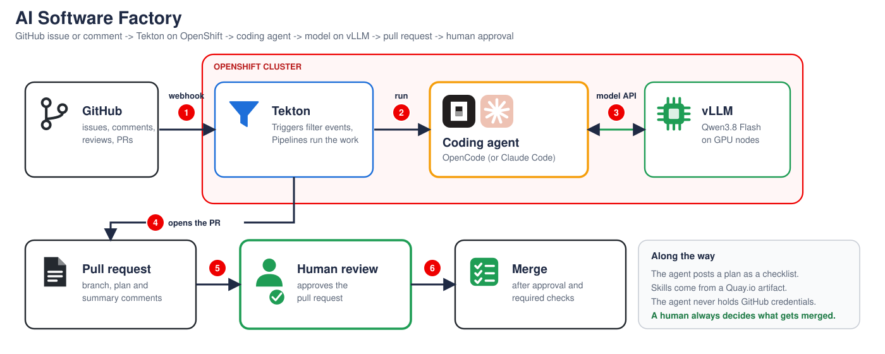
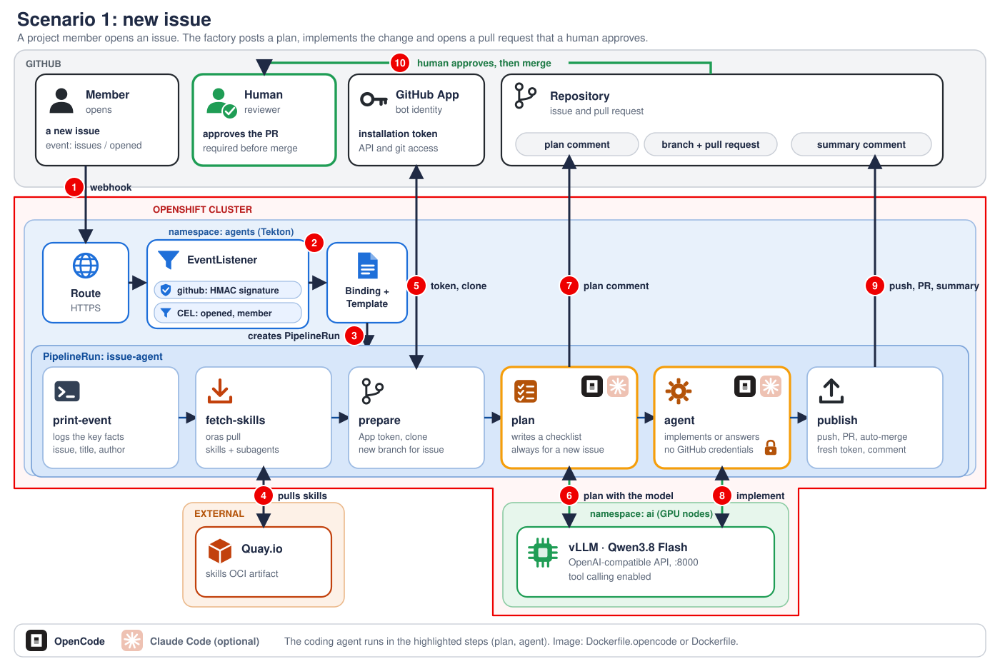
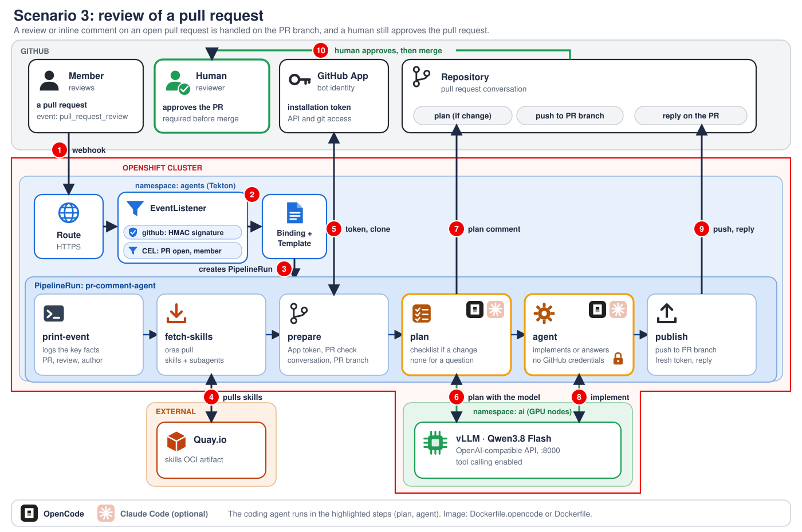
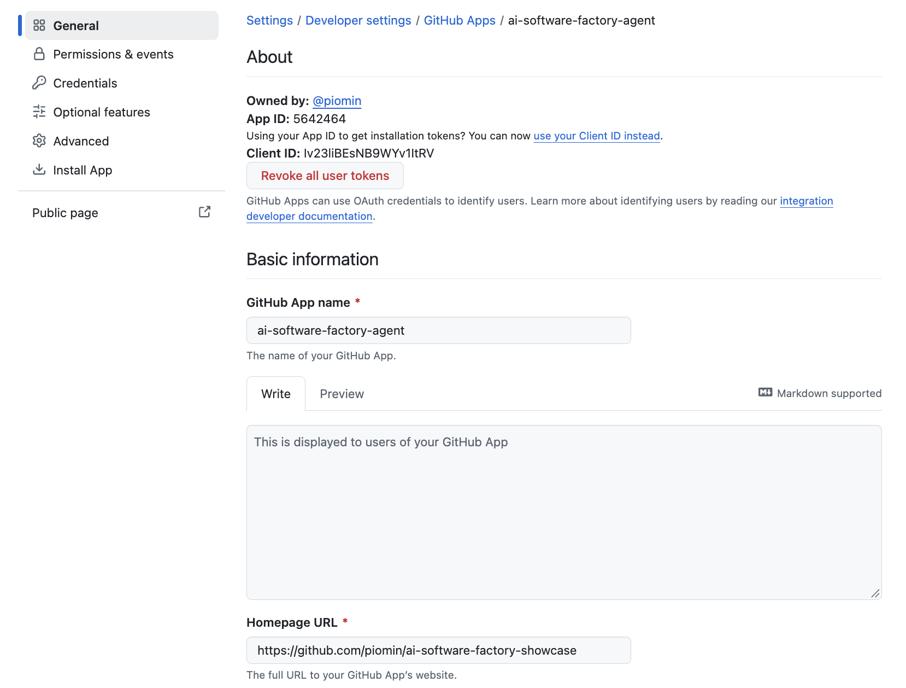
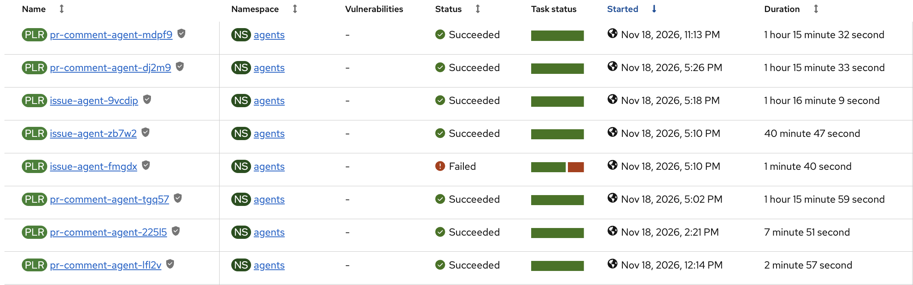
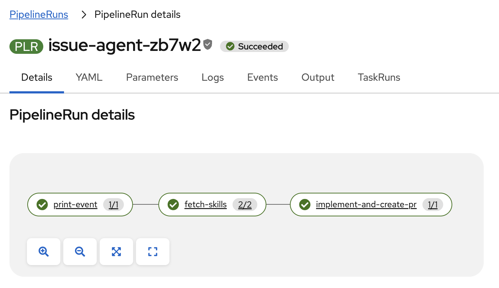
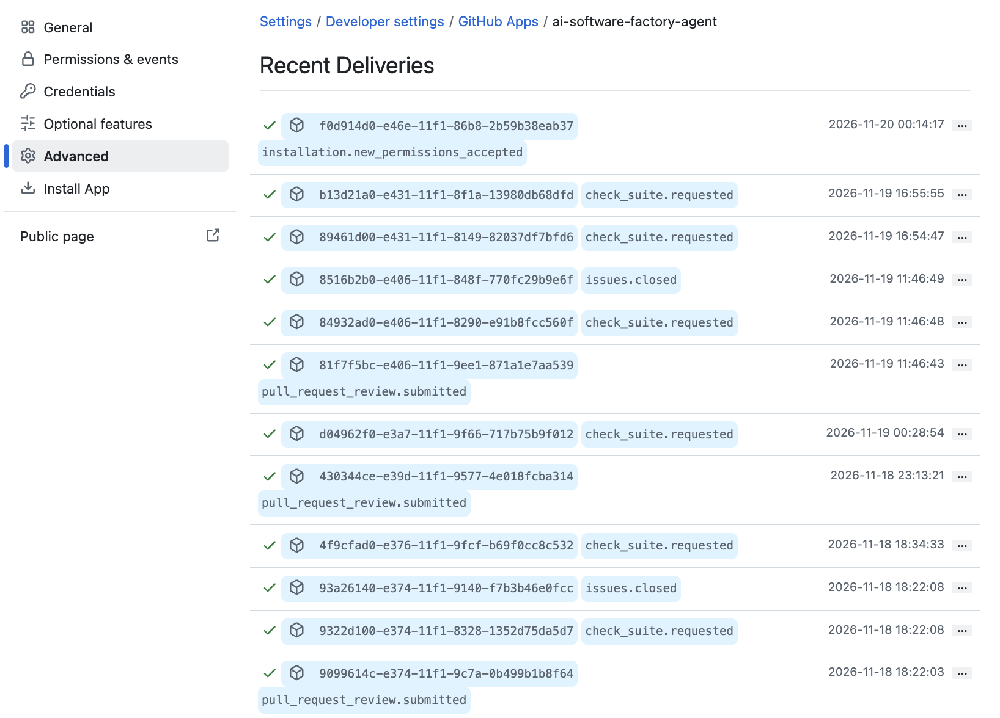
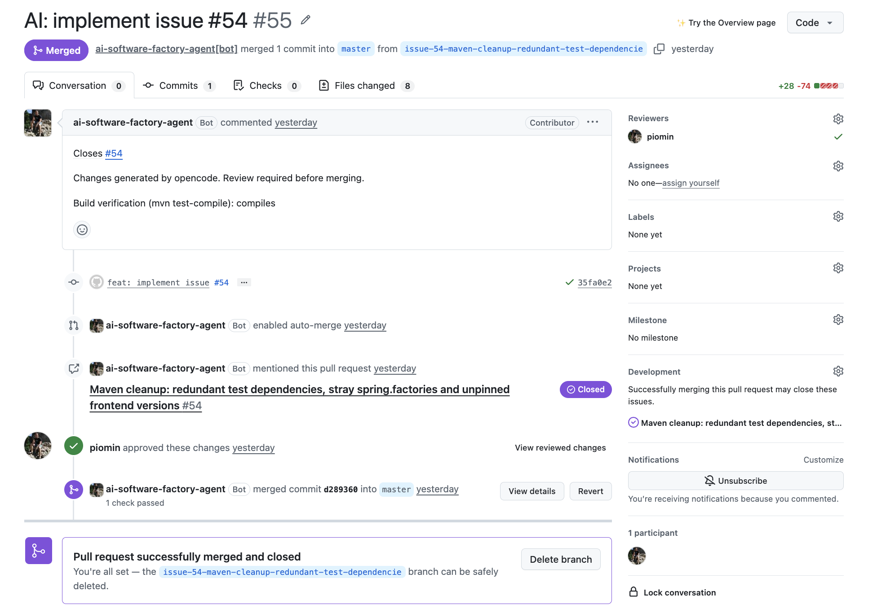

# AI Software Factory on Kubernetes

A self-hosted "software factory" that turns GitHub issues and comments into pull requests.
GitHub events are received by Tekton Triggers, executed as Tekton pipelines, and handled by a
coding agent. Two agent engines are available and every task can go to either of them:
[OpenCode](https://opencode.ai) with an [OpenCode Go](https://opencode.ai/docs/go/) subscription, and
[Claude Code](https://code.claude.com) with a Claude subscription. Which engine does what is set in one
ConfigMap and can be overridden per issue or pull request with a GitHub label.

It runs on any Kubernetes with Tekton: k3s or upstream Kubernetes (`deploy/k3s`) and OpenShift with
OpenShift Pipelines (`deploy/openshift`). No GPU is needed: the models are hosted APIs.


*The factory at a glance: two ways in (a GitHub event, or the hourly scan of `requirements` issues), Tekton, the coding agent, the pull request with human approval, and the loop back: a merged pull request closes its task issue and the next scan releases the tasks that were waiting. The drawing still shows the earlier self-hosted model (vLLM on OpenShift); the flow is the same.*

```
GitHub (issue, comment, review)
   │  webhook
   ▼
Ingress (k3s: Traefik) / Route (OpenShift) ──► EventListener (Tekton Triggers)
                      ├─ github interceptor  (HMAC signature check)
                      └─ cel interceptor     (who / what / which event is allowed)
                         │
                TriggerBinding ─► TriggerTemplate ─► PipelineRun
                                                        │
              ┌─────────────────────────────────────────┘
              ▼
   print-event ─► fetch-skills ─► prepare ─► plan ─► agent ─► verify ─► publish
                      │              │        │       │         │          │
                 OCI artifact     clone,    plan as  engine    build,     commit, push,
                 (skills, agents) branch,   comment  per task  test, fix  PR, reply
                                  labels             (OpenCode Go / Claude Code)
```

## What it does

| Pipeline | Triggered by | What happens |
|---|---|---|
| `issue-agent` | a new issue (`issues` / `opened`) | Posts a checklist plan as an issue comment, implements the issue on a new branch, opens a pull request, enables auto-merge and replies with a summary. |
| `issue-comment-agent` | an issue comment starting with `@ai` | Treats the comment as an instruction. A question gets an answer; a change request gets a plan, a branch and a pull request. |
| `pr-comment-agent` | a pull request review or review comment | Reads the whole PR conversation, pushes the requested change to the PR branch (or answers a question) and replies on the PR. |
| `requirements-agent` | the hourly `requirements-scan` CronJob, for open issues labeled `requirements` | Compares the requirements with the code and creates the task issues in dependency order, at most 3 open at a time (section 6.9). Each task issue then runs through `issue-agent`. |

Every pipeline starts with the `authorize` task, which goes on only when the author has `write`,
`maintain` or `admin` permission on the repository (read through the GitHub App API), or is the GitHub
App itself (the task issues that the requirements agent creates). The webhook's `author_association`
is not used: it says `NONE` for org members whose membership is private. A rejected run ends there
without commenting. New issues are skipped when labeled `manual` or `requirements`. Comment and review
triggers ignore bots. Forks and closed issues or pull requests are skipped, so an issue opened by a
stranger on a public repository does nothing.

## Why these technologies

| Technology | Why |
|---|---|
| **Kubernetes (k3s, OpenShift)** | One platform for pipelines and agents. Each agent run is an isolated pod, so many agents run in parallel and the scheduler places them. Secrets, RBAC and network policies come built in. k3s is enough; nothing needs OpenShift. |
| **Tekton** | Kubernetes-native CI. Tekton Triggers turn a GitHub webhook straight into a `PipelineRun`, with signature checks and CEL filters. Every run is a recorded object that can be retried, logged and timed. |
| **Two agent engines** | OpenCode with OpenCode Go gives cheap access to many open models; Claude Code gives Claude models with a subscription. Routing per task (plan, implement, fix, requirements) and per issue lets you put each kind of work on the engine that does it best and compare them on real issues. |
| **OpenCode** | Open-source coding agent that works with many model providers. Permissions are declared in a config file. |
| **Claude Code** | Anthropic's coding agent, run non-interactively (`claude -p`) with the same permission rules. |
| **GitHub App** | Short-lived installation tokens instead of personal access tokens, with fine-grained permissions and its own bot identity. |
| **OCI artifact for skills** | Skills and subagents are versioned and pulled from the same registry as images, with no extra infrastructure. |

## Showcase

The approach described here is in use in a sample application repository:
[piomin/ai-software-factory-showcase](https://github.com/piomin/ai-software-factory-showcase).
The GitHub App from this guide is installed there, and the repository has an `AGENTS.md` with the
rules the agent follows. Browse its closed issues and merged pull requests to see the factory at
work: the plan comment on a new issue, the pull request opened by the bot, the human approval and
the auto-merge. The GitHub screenshots in this README come from that repository.

## Event flows

Each diagram follows one event from GitHub through the cluster (ingress, EventListener,
PipelineRun in the `agents` namespace) to the coding agent and back to GitHub. The numbers show the
order of the main interactions. The orange-framed steps (`plan`, `agent`) are where the coding agent
runs; today that is OpenCode or Claude Code, chosen per task. The diagrams were drawn for the earlier
setup with a self-hosted model on OpenShift: read "model" as the hosted API of the chosen engine. Quay.io
only serves the skills artifact. The OpenCode and Claude Code icons are simplified drawings, not the
official logos.

### Scenario 1: new issue



### Scenario 2: comment on an issue


### Scenario 3: review of a pull request



## Repository layout

```
.
├── agents/                              the agent: image and shared configuration
│   ├── Dockerfile                       the agent image: OpenCode and Claude Code, gh, JDK, Maven (built by .github/workflows/agent-image.yml)
│   ├── configmap-agent-config.yaml      engine routing, agent-run.sh, OpenCode and Claude Code permissions, GitHub App token script, requirements helpers
│   ├── kustomization.yaml               agent-config and the skills ConfigMap
│   └── skills/                          skills delivered as a ConfigMap (requirements-breakdown)
├── tekton/                              pipelines and everything that triggers them (common to all platforms)
│   ├── kustomization.yaml               all common manifests
│   ├── pipeline-*.yaml                  the event pipelines and the requirements pipeline
│   ├── task-*.yaml                      shared tasks: fetch-skills, verify-build, report-failure, create-issues
│   ├── triggerbinding-*.yaml            map webhook payloads to pipeline parameters
│   ├── triggertemplate-*.yaml           create the PipelineRuns
│   ├── eventlistener-new-issue.yaml     the single EventListener with four triggers and their filters
│   ├── cronjob-requirements-scan.yaml   hourly scan of `requirements` issues (section 6.9)
│   ├── resourcequota-agents.yaml        optional cap on parallel runs
│   └── serviceaccount-*, role*-*        service accounts and RBAC of the listener and the scan
├── deploy/
│   ├── k3s/                             namespace, `pipeline` service account, Traefik Ingress, install notes
│   └── openshift/                       the Route
├── secrets/                             secret skeletons with placeholders only (never commit real values)
├── install/README.md                    log of the earlier ROSA (OpenShift on AWS) test cluster
├── .github/workflows/agent-image.yml    builds and pushes the agent image to GHCR
└── docs/
    ├── diagrams/                        SVG diagrams of the three event flows
    └── images/                          screenshots used in this README
```

Namespace used: `agents`, for pipelines, triggers and agent runs.

## 1. Prerequisites

### 1.1 Cluster

- A Kubernetes cluster: **k3s** or upstream Kubernetes, or **OpenShift** (the factory was first built on ROSA).
- A default `StorageClass` that supports `ReadWriteOnce`. Every `PipelineRun` creates two small volumes.
  k3s ships `local-path`, which works.
- An ingress controller that GitHub can reach from the internet. k3s ships Traefik; the entry point still
  has to be published (public IP, reverse proxy, port forward or tunnel). OpenShift uses a Route.
- Outbound HTTPS from the `agents` namespace to `github.com`, `api.github.com`, the image registries
  (`ghcr.io`, `quay.io`, `registry.access.redhat.com`), `opencode.ai` and `api.anthropic.com`.

### 1.2 Tekton

**k3s / upstream Kubernetes.** Install Tekton Pipelines, Tekton Triggers and the Triggers interceptors
from the upstream releases (or with Helm / Argo CD). Pin versions that work together:

```bash
kubectl apply -f https://storage.googleapis.com/tekton-releases/pipeline/latest/release.yaml
kubectl apply -f https://storage.googleapis.com/tekton-releases/triggers/latest/release.yaml
kubectl apply -f https://storage.googleapis.com/tekton-releases/triggers/latest/interceptors.yaml
kubectl get pods -n tekton-pipelines
kubectl get clusterinterceptors          # github and cel must be listed
```

**OpenShift.** Install **Red Hat OpenShift Pipelines** from OperatorHub. It provides Tekton Pipelines,
Tekton Triggers, the `github` and `cel` cluster interceptors and a `pipeline` service account in
every namespace.

**Turn the affinity assistant off (both platforms).** The pipelines give one task two volumes (`skills`
and `work`). By default Tekton schedules such pods with an affinity assistant that refuses more than one
volume per task: the run fails with `TaskRunValidationFailed: more than one PersistentVolumeClaim is bound`.
With the assistant off, each task waits for its volume to move between pods, usually well under a minute:

```bash
# k3s / upstream
kubectl patch cm feature-flags -n tekton-pipelines --type merge -p '{"data":{"coschedule":"disabled"}}'
# OpenShift Pipelines (the operator owns feature-flags, so patch its TektonConfig)
oc patch tektonconfig config --type merge -p '{"spec":{"pipeline":{"coschedule":"disabled"}}}'
```

### 1.3 Local tools

`kubectl` (on OpenShift `oc` works the same), optionally `tkn` and `gh`. `podman` and `oras` are only
needed if you build your own agent image or publish your own skills artifact (section 4). To create
the Claude Code token you need the `claude` CLI once on your own machine (section 3).

### 1.4 Namespace

`deploy/k3s` creates the `agents` namespace. On OpenShift create it first: `oc new-project agents`.

## 2. GitHub

### 2.1 Create the GitHub App

Create a GitHub App (Settings, Developer settings, GitHub Apps) with:

- **Repository permissions**: Contents *read and write*, Pull requests *read and write*,
  Issues *read and write*, Metadata *read-only*.
- **Subscribe to events**: Issues, Issue comment, Pull request review, Pull request review comment.
- **Webhook**: leave it for later (section 7); you need the public URL of the listener first. Set a
  webhook secret now (you will store it as `github-webhook-secret`). Use a long random value, for
  example `openssl rand -hex 32`.


*Repository permissions of the GitHub App: Contents, Pull requests and Issues set to read and write.*


*Events the app subscribes to: Issues, Issue comment, Pull request review and Pull request review comment.*

The app acts as its own bot user. The pipelines authenticate as the app by minting short-lived
installation tokens, so no personal access token is needed.

### 2.2 Install the app and collect identifiers

1. Install the app on the repository (or repositories) the factory should work on.
2. Collect:
   - **App ID**: shown on the app's settings page.
   - **Installation ID**: the number at the end of
     `https://github.com/settings/installations/<ID>` after you open the installation.
   - **Private key**: generate one on the app's settings page and keep the `.pem` file.


*The app's settings page: the App ID is shown under About.*

### 2.3 Repository settings

- Enable **Allow auto-merge** in the repository settings. The pipelines call
  `gh pr merge --auto`. Auto-merge only waits for something if branch protection requires
  reviews or checks, so configure branch protection on the default branch. Without it a pull
  request is merged right away.


*Repository settings: Allow auto-merge enabled and a branch protection rule requiring a review and status checks.*

- Put an `AGENTS.md` in each target repository. Both engines are told to follow it. Typical content:
  coding conventions, "do not edit `target/`", how to build and test the project, and an instruction
  to run the tests and report the result honestly. `verify` builds and tests the result (section 6.7),
  but these rules are still the main quality gate.
- Create the engine labels if you want to route single issues (section 6.1):

  ```bash
  for l in engine:claude engine:opencode; do gh label create "$l" --repo <owner>/<repo> --color 0e8a16; done
  ```

### 2.4 Commit identity

The pipelines set the commit author to our GitHub App, `klaudiuszai[bot]`, with the email
`290278935+klaudiuszai[bot]@users.noreply.github.com`. The `new-issue` CEL filter also accepts issues
opened by this bot. For another app, replace the name and the number in the `GIT_AUTHOR_*` and
`GIT_COMMITTER_*` variables of the `publish` steps and the login in `tekton/eventlistener-new-issue.yaml`
with your app's slug and bot user id:

```bash
gh api "/users/<app-slug>%5Bbot%5D" --jq .id
```

## 3. Secrets

The `secrets/` directory holds secret **skeletons** with placeholders only. Never commit real
values: fill in a local copy, or create the secrets with `kubectl create secret` as shown below.

| Secret | Keys | Used by |
|---|---|---|
| `github-app` | `app-id`, `installation-id`, `private-key.pem` | `prepare`, `publish`, `create-issues`, `report-failure` and the scan: mint installation tokens |
| `github-webhook-secret` | `secret` | the EventListener: verifies every delivery; same value as in the GitHub App |
| `opencode-go` | `api-key` | the `opencode` engine, as `OPENCODE_API_KEY` |
| `claude-code-oauth` | `token` | the `claude` engine, as `CLAUDE_CODE_OAUTH_TOKEN` |

```bash
kubectl create secret generic github-app -n agents \
  --from-literal=app-id=<APP_ID> \
  --from-literal=installation-id=<INSTALLATION_ID> \
  --from-file=private-key.pem=./<app-private-key>.pem
kubectl create secret generic github-webhook-secret -n agents --from-literal=secret=<WEBHOOK_SECRET>
kubectl create secret generic opencode-go -n agents --from-literal=api-key=<OPENCODE_GO_API_KEY>
kubectl create secret generic claude-code-oauth -n agents --from-literal=token=<CLAUDE_CODE_OAUTH_TOKEN>
```

Create the model secret of every engine you route tasks to; the keys are optional in the pods, so an
engine without its secret only fails when a task is actually sent to it.

- **OpenCode Go key**: from the OpenCode console, with an active Go subscription. List the models it gives
  you with `curl -H "Authorization: Bearer <key>" https://opencode.ai/inference/go/v1/models`.
- **Claude Code token**: run `claude setup-token` on your own machine and approve it in the browser. It
  prints a token that is valid for one year and uses your Claude subscription (Pro, Max, Team or
  Enterprise); it is not stored anywhere else. The token shares the usage limits of that subscription,
  so parallel agent runs count against your own Claude usage. For heavy use an API key
  (`ANTHROPIC_API_KEY`) is the alternative. Put a reminder in your calendar before the token expires.

**Private images.** If the agent image or the skills artifact is private, create a pull secret and
attach it to the `pipeline` service account:

```bash
kubectl create secret docker-registry ghcr-pull -n agents \
  --docker-server=ghcr.io --docker-username=<user> --docker-password=<token with read:packages>
kubectl patch serviceaccount pipeline -n agents -p '{"imagePullSecrets":[{"name":"ghcr-pull"}]}'
```

## 4. Container images and skills

### 4.1 Agent image

The pipelines use `ghcr.io/majowka/factory-agent:latest`, built from [`agents/Dockerfile`](agents/Dockerfile)
by the `agent-image` GitHub Actions workflow. Every build is tagged with its commit SHA; `latest` is
only pushed from `master`. The image runs in the `prepare`, `plan`, `agent`, `verify` and `publish`
steps and contains both agent engines (OpenCode and Claude Code), the GitHub CLI, a JDK, Maven,
`skaffold` and `kubectl`.

To test a branch before it is merged, point the pipelines at the SHA tag of its build:

```bash
sed -i 's#ghcr.io/majowka/factory-agent:latest#ghcr.io/majowka/factory-agent:<sha>#g' tekton/*.yaml
```

**Only if you need a different configuration** (another JDK, extra CLIs, another toolchain), adapt
the Dockerfile, build and push your own image, and point the pipelines at it:

```bash
podman build -f agents/Dockerfile -t <registry>/<org>/factory-agent:<tag> agents/
podman push <registry>/<org>/factory-agent:<tag>
sed -i 's#ghcr.io/majowka/factory-agent:latest#<registry>/<org>/factory-agent:<tag>#g' tekton/*.yaml
```

`skaffold` and `kubectl` are in the image so that an agent can deploy an application to
Kubernetes. They do nothing by default: the agent pods have no kubeconfig or RBAC. Granting that
is a separate and security-sensitive step, and `skaffold` also needs a builder (Jib, buildpacks
or Kaniko) and a registry to push to.

### 4.2 Skills artifact

Skills and subagents are distributed as an OCI artifact: one `tar.gz` with `skills/` and
`agents/` directories in OpenCode format. The `fetch-skills` task pulls it with `oras` and unpacks it
to `/skills/opencode`. The `prepare` step (`agent-home.sh`) installs it for both engines: everything
into `~/.config/opencode`, and the skills (the `SKILL.md` format is the same) into `~/.claude/skills`.
OpenCode subagents (`agents/*.md`) use another format and are only available to OpenCode.

The pipelines pull `quay.io/pminkows/claude-ai-spring-boot:1.3.2` by default (the
`skills-artifact` parameter), so there is nothing to publish to get started.

**Only if you want your own skills**, publish them as an artifact and set the `skills-artifact`
parameter of the pipelines to it:

```bash
tar -czf skills.tar.gz skills agents
oras push quay.io/<org>/<skills-repo>:<version> skills.tar.gz
```

## 5. The AI models

The factory runs no model of its own. Agent tasks go to one of two hosted engines:

| Engine | Models | Authentication | Secret |
|---|---|---|---|
| `opencode` | OpenCode Go models, `opencode-go/<model-id>` (default `opencode-go/deepseek-v4.1-flash`) | API key | `opencode-go` |
| `claude` | Claude models, an alias such as `sonnet` or `opus`, or a full model id | OAuth token from `claude setup-token` | `claude-code-oauth` |

Which engine and model handle which task is set in `routing.env` (section 6.1). Both subscriptions have
usage limits (OpenCode Go: a 5-hour, a weekly and a monthly allowance; Claude: the limits of your plan).
Code and issue text are sent to the provider of the engine that runs the task.

## 6. Tekton: pipelines, triggers and the listener

### 6.1 Agent configuration (ConfigMap)

[`agents/configmap-agent-config.yaml`](agents/configmap-agent-config.yaml) is shared by all pipelines and
mounted at `/config`:

| Key | Purpose |
|---|---|
| `routing.env` | Which engine (`opencode` or `claude`) runs which task, and the model of each engine. |
| `agent-run.sh` | Runs one task with the chosen engine: `agent-run.sh <task> <timeout> <log> <prompt>`. Every agent call in the pipelines goes through it. |
| `agent-home.sh` | Installs the fetched skills for both engines. |
| `opencode.json` | OpenCode permissions and the OpenCode Go provider (key from `OPENCODE_API_KEY`). |
| `claude-settings.json` | Claude Code permissions, the same rules as `opencode.json`. |
| `gh-app-token.sh` | Mints a GitHub App installation token (valid 1h). |
| `requirements-lib.sh` | Helpers of the requirements scan and the requirements agent. |

**Routing.** Every agent call names its task:

| Task | Where | Default engine |
|---|---|---|
| `PLAN` | `plan` step of the three event pipelines | `opencode` |
| `IMPLEMENT` | `agent` step of the three event pipelines | `claude` |
| `FIX` | build-fix attempts in `verify-build` | `claude` |
| `REQUIREMENTS` | `analyze` step of the requirements agent | `opencode` |

```bash
AGENT_ENGINE_DEFAULT=opencode
AGENT_ENGINE_PLAN=opencode
AGENT_ENGINE_IMPLEMENT=claude
AGENT_ENGINE_FIX=claude
AGENT_ENGINE_REQUIREMENTS=opencode
OPENCODE_MODEL=opencode-go/deepseek-v4.1-flash # per task: OPENCODE_MODEL_<TASK>
CLAUDE_MODEL=sonnet                     # per task: CLAUDE_MODEL_<TASK>
CLAUDE_MODEL_PLAN=opus
```

To move a task to the other engine, change its line and `kubectl apply -k agents`; the next run uses it.

**Per issue or pull request: labels.** A label overrides `routing.env` for that issue or PR only:

| Label | Effect |
|---|---|
| `engine:claude` / `engine:opencode` | every task of this issue or PR runs on that engine |
| `engine-<task>:<engine>` | one task only, e.g. `engine-implement:opencode`, `engine-plan:claude` |

The task-specific label wins over `engine:...`, and both win over `routing.env`. The `prepare` steps read
the labels when the run starts, so a label added later applies to the next run (the next comment). Tasks
created by the requirements agent inherit the `engine...` labels of their requirements issue. The log
of each agent call starts with the engine and model it used (`=== IMPLEMENT: claude sonnet ===`).

**Permissions.** In both engines the agent may read and edit files and run shell commands, but
`git commit`, `git push`, `gh` and web access are denied. In non-interactive mode anything that is not
allowed is refused instead of prompting. No agent step has GitHub credentials: the `plan` steps write
`/workspace/out/plan.md` and the script posts it; the `publish` steps commit and open the pull request.

### 6.2 Install

Everything except the secrets is applied with kustomize. The common manifests are in `agents/` and
`tekton/`; the overlay adds what differs per platform:

| | k3s / upstream (`deploy/k3s`) | OpenShift (`deploy/openshift`) |
|---|---|---|
| Namespace `agents` | created by the overlay | `oc new-project agents` |
| `pipeline` service account | created by the overlay | created by OpenShift Pipelines |
| Public endpoint of the listener | Traefik `Ingress`: set the host and TLS in `deploy/k3s/ingress-new-issue.yaml` | `Route`, host generated by OpenShift |

```bash
kubectl apply -k deploy/k3s          # or: oc apply -k deploy/openshift
```

Then create the secrets (section 3). [`deploy/k3s/README.md`](deploy/k3s/README.md) has the k3s steps in one place.

The EventListener runs under its own service account `issue-agent-listener`, bound to the cluster roles
that Tekton Triggers provides for listeners: `tekton-triggers-eventlistener-roles` (RoleBinding) and
`tekton-triggers-eventlistener-clusterroles` (ClusterRoleBinding). The second one is needed because the
listener reads the cluster-scoped `ClusterInterceptor` objects; without it the listener pod crash-loops
with `cannot list resource "clusterinterceptors"`.

### 6.3 Pipelines

All three event pipelines have the same shape: `print-event`, `fetch-skills`, one long task
(`prepare`, `plan` and `agent` steps), `verify` and `publish`. A `finally` task, `report-failure`,
comments on the issue or pull request when the run fails. The steps that are the same in every
pipeline are shared `Task` resources (`tekton/task-*.yaml`), referenced with `taskRef`:

| Task | Used for |
|---|---|
| `fetch-skills` | pulls and unpacks the skills artifact |
| `verify-build` | builds and tests the result, the agent fixes a red build |
| `report-failure` | comments on the issue or pull request when the run failed |

The pipelines keep only what differs: the event parameters and the `prepare`, `plan`, `agent` and
`publish` logic. Two optional parameters control `verify`: `verify-command` (default:
`mvn -B -ntp verify` when there is a `pom.xml`, `skip` disables it) and `max-fix-attempts`
(default `3`). Two workspaces are volumes that every `PipelineRun` creates for itself: `skills`
(the unpacked skills) and `work` (the clone, the plan, the labels and the summary, shared by all tasks
after `fetch-skills`). Every `PipelineRun` runs under the `pipeline` service account.

The heart of `tekton/pipeline-issue-agent.yaml` (shortened):

```yaml
- name: prepare                        # holds the GitHub App key
  script: |
    bash /config/agent-home.sh /skills/opencode            # skills for both engines
    GH_TOKEN="$(bash /config/gh-app-token.sh)"; export GH_TOKEN
    gh issue view "$ISSUE_NUMBER" --json labels -q '.labels[].name' > /workspace/agent-labels
    ( umask 077; printf '%s' "$GH_TOKEN" > /workspace/gh-token )   # for the plan step's script only
    git clone --branch "$BASE_BRANCH" -- "$REPO_URL" /workspace/repo
    git switch -c "issue-${ISSUE_NUMBER}-${SLUG}"

- name: plan                           # the agent gets no token; the script posts the plan
  env: [OPENCODE_API_KEY, CLAUDE_CODE_OAUTH_TOKEN]          # from the secrets, both optional
  script: |
    PLAN_GH_TOKEN="$(cat /workspace/gh-token)"; rm -f /workspace/gh-token
    bash /config/agent-run.sh plan 15m /workspace/plan.log "Write the plan to /workspace/out/plan.md ..."
    [ -s /workspace/out/plan.md ] && GH_TOKEN="$PLAN_GH_TOKEN" gh issue comment "$ISSUE_NUMBER" --body-file /workspace/out/plan.md
    git reset -q --hard && git clean -qfd                    # planning must not leave changes behind

- name: agent                          # no GitHub credentials at all
  script: |
    bash /config/agent-run.sh implement 3h /workspace/agent.log "Implement this GitHub issue ... $(cat /workspace/issue.txt)"
    # the agent writes a short summary to .agent-summary.md; it is moved out of the repository
```

`publish` then mints a fresh token, commits, pushes, opens the pull request (`Closes #<issue>`),
enables auto-merge and posts the summary on the issue.

The other two pipelines differ in what they read and where they write:

- `tekton/pipeline-issue-comment-agent.yaml`: `prepare` fetches the whole issue thread through the
  API and creates a branch per comment (`issue-<n>-<slug>-c<comment id>`). `plan` posts a plan
  only when the comment asks for a code change. `publish` opens a pull request only if files
  changed, and always replies on the issue.
- `tekton/pipeline-pr-comment-agent.yaml`: `prepare` checks that the PR is open and not from a
  fork, collects the description, comments, reviews and inline comments, and clones the PR branch.
  `publish` pushes to that branch and replies on the pull request.


*PipelineRuns of the three pipelines in the `agents` namespace (OpenShift Pipelines console; on k3s use `tkn` or the Tekton Dashboard).*

**Why the scripts `cd /workspace/repo` instead of using `workingDir`.** A step with
`workingDir: /workspace/repo` makes Tekton create that directory in an init container, which can run
as root. The `prepare` step runs as a normal user and then cannot clone into the root-owned directory
(`/workspace/repo/.git: Permission denied`). The steps therefore use `workingDir: /workspace` and
change into the repository themselves, so `git clone` creates the directory.

### 6.4 Trigger bindings and templates

A **TriggerBinding** copies fields from the GitHub webhook payload into parameters. The one for new
issues (`tekton/triggerbinding-new-issue.yaml`) reads `body.repository.clone_url`, `full_name` and
`default_branch`, and `body.issue.number`, `title`, `body`, `id` and `user.login`. The binding for issue
comments adds the event type (`$(header.X-Github-Event)`) and the comment (`body.comment.id`,
`user.login`, `body`). The two pull request bindings read `body.pull_request.number`, `title` and
`head.ref`, and take the author and text from `body.comment` (review comment) or `body.review` (review).

A **TriggerTemplate** turns those parameters into a `PipelineRun` with a fixed name, the global
timeouts, `taskRunTemplate.serviceAccountName: pipeline` and two `volumeClaimTemplate` workspaces
(1 GiB `skills`, 10 GiB `work`).

### 6.5 EventListener and public endpoint

The **EventListener** (`tekton/eventlistener-new-issue.yaml`) is the single entry point. Every
trigger first verifies the webhook signature (`github` interceptor with `github-webhook-secret`) and
then filters with CEL (`cel` interceptor). Only events that pass both reach a binding and a template.
Tekton Triggers creates the service `el-new-issue` (port `http-listener`) for it.

That service is published over HTTPS by `deploy/k3s/ingress-new-issue.yaml` (Traefik) or
`deploy/openshift/route-new-issue.yaml` (Route). Its URL is the payload URL of the GitHub webhook
(section 7).

### 6.6 How events become pipeline runs

The `new-issue` EventListener has four triggers. Each verifies the webhook signature with the
`github-webhook-secret` secret, filters with CEL, and then maps the payload with a binding.

| Trigger | GitHub event | CEL filter (all conditions) | Template, pipeline |
|---|---|---|---|
| `new-issue` | `issues` | action `opened`, issue **without** the `manual` or `requirements` label | `new-issue`, `issue-agent` |
| `issue-comment` | `issue_comment` | action `created`, issue open, **not a pull request**, not a bot, **body starts with `@ai`** | `issue-comment`, `issue-comment-agent` |
| `pr-review-comment` | `pull_request_review_comment` | action `created`, PR open, not a bot | `pr-comment`, `pr-comment-agent` |
| `pr-review` | `pull_request_review` | action `submitted`, PR open, not a bot, non-empty body | `pr-comment`, `pr-comment-agent` |

Each `PipelineRun` gets its own volumes (`volumeClaimTemplate`): 1 GiB for the skills workspace and
10 GiB for the work workspace (the clone and the Maven cache). The only Tekton timeouts are
global, set in the TriggerTemplates: 3 hours for all tasks together and 15 minutes reserved for
`finally`, so the failure comment can still be posted. The steps bound themselves with timeouts passed
to `agent-run.sh` (agent 3 h, planning 15 min, each fix 15 min) and in their scripts (each build 20 min,
and a 45 minute budget for the whole fix loop).

The name of a `PipelineRun` is fixed and built from the event: `issue-agent-<issue id>`,
`issue-comment-agent-<comment id>` and `pr-comment-agent-<c|r><comment or review id>`. GitHub
redelivers a webhook after a timeout or on request, and Tekton refuses a second run with the same
name, so one event never produces two pull requests. To run an event again on purpose, delete the
old `PipelineRun` and redeliver the webhook.

To limit how many runs work at the same time, apply `tekton/resourcequota-agents.yaml` (optional; it is
commented out in `tekton/kustomization.yaml`). It caps the pods in the `agents` namespace, and Tekton
keeps the extra TaskRuns waiting instead of failing them. The waiting time counts against the timeout.
With hosted models this also caps how much of your subscription limits parallel runs can use.

### 6.7 What a run does

1. **`print-event`**: prints the key facts of the event to the log.
2. **`fetch-skills`**: `oras pull` of the skills artifact, then unpack.
3. **`prepare`**: mints a GitHub App installation token, saves the labels of the issue or PR (they can
   choose the engine), fetches the issue or PR conversation, installs the skills for both engines,
   clones the repository and creates the working branch. This is the only step besides `publish` that
   holds the GitHub App private key.
4. **`plan`**: the agent (task `PLAN`) decides whether code changes are needed. If so, it writes a
   checklist (`- [ ] ...`) to `/workspace/out/plan.md`, and the script posts it as a comment on the issue
   or pull request. Questions are not planned (`issue-agent` always plans, because a new issue is always
   a task). In `pr-comment-agent` review remarks are not taken blindly: both steps load the
   `review-triage` skill from the skills artifact, each remark is checked against the code and the plan
   has a `Not doing` section with the reasons for rejected or partly accepted points. The `agent` step
   implements only the checklist and its summary says, point by point, what was and was not done.
5. **`agent`**: the agent (task `IMPLEMENT`) implements the change, following the plan and the
   repository's `AGENTS.md`. It writes a short summary to `.agent-summary.md`. It has 3 hours.
6. **`verify`** (its own task): builds and tests the result (the script is in the `verify-build` Task). If
   the build fails, the agent (task `FIX`) gets the end of the log and fixes the code, up to
   `max-fix-attempts` times and within 45 minutes. The step never fails: it leaves a note with the result.
7. **`publish`** (its own task): mints a fresh token, commits and pushes. The issue pipelines also open a
   pull request and enable auto-merge; `pr-comment-agent` pushes to the existing PR branch. The agent's
   summary is then posted as a comment, preceded by the verification result. If the build stays
   red, the pull request is opened as a **draft**, auto-merge is not enabled and the comment
   contains the end of the build log.
8. **`report-failure`** (`finally`): only when the run failed or timed out. Comments on the issue
   or pull request with the name of the `PipelineRun` and how to read its logs, so a failure is
   not silent.


*A finished `issue-agent` run: `print-event`, `fetch-skills` and `implement-and-create-pr`.*

### 6.8 Security model

- No agent step has **GitHub credentials**. Committing, pushing, any `gh` command and web access are
  denied in `opencode.json` and `claude-settings.json`. The `plan` step's script holds a one-hour
  installation token (not the private key) only to post the plan after the agent has finished; the
  agent process never sees it.
- A fresh token is minted in `publish`, because an agent run can exceed the one-hour token lifetime.
- The agent steps hold the model credentials of the engines (`OPENCODE_API_KEY`,
  `CLAUDE_CODE_OAUTH_TOKEN`). The agent has a broad `bash` permission, so treat them as readable by the
  agent: a prompt injection in an issue could try to leak them. Keep them scoped to this use, watch the
  usage, and rotate them if in doubt.
- Only accounts with `write` permission or more on the repository (and the GitHub App, for the task
  issues of the requirements agent) get past the `authorize` task, and only they can set the `engine` labels. Bot events are
  ignored in the comment and review flows, and pull requests from forks are rejected. The App's own
  login is the `bot-login` parameter of `task-authorize-author.yaml`: change it if your App has another name.
- Issue and comment text is untrusted input that reaches the model, and with hosted engines code and
  issue text leave the cluster to the provider of the engine. Keep the pods free of cluster credentials,
  and consider a `NetworkPolicy` that limits egress to GitHub, the model providers and your Maven
  repositories.

### 6.9 Requirements agent (issues with the `requirements` label)

A requirements issue is turned into task issues by a scheduled scan, not by a webhook. The task issues then
run through the normal `issue-agent` flow. Nothing is stored outside GitHub.

```
CronJob requirements-scan (every hour, no AI)
   for each open issue labeled `requirements`:
      edited or never analyzed ........ analyze  (agent compares requirements and code, plans the missing tasks)
      a task became ready ............. release  (no agent, creates the task issues whose dependencies are done)
      every task done, not reviewed ... review   (agent looks for gaps; nothing missing: the issue is closed)
   └─► PipelineRun requirements-agent:  analyze (prepare + agent) ─► create-issues ─► finally report-failure
```

- **State** is a comment of the bot on the requirements issue: a table with the status of every task, plus the plan
  (task text and dependencies) in a hidden marker together with a hash of the requirements text. Task issues carry the
  label `req-<number>` and a marker `<!-- requirements:<number>:<task id> -->`.
- **Order.** The agent writes tasks with `depends_on`. `create-issues` only creates a task when every dependency is
  closed (so the agent starts from a `master` that contains the result), and never more than `max-open` (default 3) task
  issues open at a time. Task issues are not labeled `manual`, so `new-issue` starts an agent for each of them.
- **Engine.** The analysis is task `REQUIREMENTS`. Task issues inherit the `engine...` labels of the requirements issue,
  so one label on the requirements issue routes all of its tasks.
- **No repeated analysis.** The PipelineRun name is derived from the state (mode, hash, task counts), so the same state
  never starts a second run. A failed run is therefore not retried by itself: delete the PipelineRun, or edit the
  requirements issue. The agent only plans what is missing: tasks already created are passed to it and are not repeated.
- **Skill.** `agents/skills/requirements/SKILL.md` is mounted from the ConfigMap `requirements-skill` and copied to the
  skills directories of both engines by the `prepare` step. The agent has no GitHub credentials; only `create-issues`
  holds the App key and validates `issues.json` (schema, unique ids, known dependencies, no cycles, at most 15 tasks)
  before anything is created.
- **First draft early.** The prompt tells the agent to write a first draft of `issues.json` within a few tool calls and
  to refine it afterwards, so a slow or cut-off answer still leaves a valid file.
- **The scan needs no `kubectl`.** The CronJob creates the `PipelineRun` with `curl` against the Kubernetes API using its
  service account token. Set `REPOS` in `tekton/cronjob-requirements-scan.yaml` first (default: the showcase repository).
- **Running it on demand or pausing it.** `kubectl create job --from=cronjob/requirements-scan scan-now -n agents` runs a
  scan immediately (delete the job before the next one). Set `suspend: true` on the CronJob to stop the schedule; manual
  jobs still work while it is suspended.
- **Limits.** Editing a requirement adds tasks but does not change tasks that already exist. The state comment must
  stay under the 65536-character comment limit.

## 7. Connect GitHub to the cluster

The public URL of the listener is the host of the Ingress (k3s) or the Route (OpenShift):

```bash
kubectl get ingress new-issue -n agents -o jsonpath='https://{.spec.rules[0].host}{"\n"}'   # k3s
oc get route new-issue -n agents -o jsonpath='https://{.spec.host}{"\n"}'                     # OpenShift
```

In the GitHub App settings (or as a repository webhook) set:

- **Payload URL**: the URL above
- **Content type**: `application/json`
- **Secret**: the value stored in `github-webhook-secret`
- **Events**: Issues, Issue comment, Pull request review, Pull request review comment

Check *Recent deliveries* on GitHub. A `202` means the listener accepted the event; a `4xx`
usually means a wrong secret, and a timeout means GitHub cannot reach the URL.


*Recent deliveries of the app webhook: a green tick means GitHub got a successful response.*

## 8. Try it

1. Open an issue in the repository as an owner or member (for example, "Add a `/health` endpoint").
2. Watch the run:

   ```bash
   kubectl get pipelinerun -n agents
   tkn pipelinerun logs -f -n agents --last
   ```

3. The issue gets a plan comment, then a pull request and a summary comment appear. The log of each
   agent step starts with the engine and model it used.

   
   *The resulting pull request: opened by the GitHub App, approved by a human reviewer and then merged.*

4. Comment `@ai please also add a unit test` on the issue, or review the pull request with a
   comment, to trigger the follow-up pipelines.
5. Add the label `engine:opencode` (or `engine:claude`) to an issue and comment again to see the routing
   change for that issue only.

## 9. Troubleshooting

| Symptom | Check |
|---|---|
| No `PipelineRun` is created | Webhook deliveries on GitHub; `kubectl logs deployment/el-new-issue -n agents`; the CEL filter. A run that stops at `authorize` shows the author's permission in that task's log. |
| GitHub shows a timeout for every delivery | The Ingress host is not reachable from the internet: DNS, the published Traefik entry point, TLS. |
| `fetch-skills` fails | `skills-artifact` reference and registry access; the artifact must contain a `.tar.gz`. |
| Pods fail with `ImagePullBackOff` | The agent image tag exists (only `master` builds push `latest`), and the GHCR package is public or the `pipeline` service account has a pull secret (section 3). |
| `prepare` fails when minting a token | App ID, installation ID, key format of the `github-app` secret; the app must be installed on the repository. |
| An agent step ends at once with an authentication error | The secret of the engine the task was routed to (`opencode-go` or `claude-code-oauth`) exists and is valid; the Claude token expires after one year. The first log line names the engine. |
| An agent step fails with a usage or rate limit error | The subscription limits of that engine. Move the task to the other engine (`routing.env` or a label), or lower parallelism with the ResourceQuota. |
| `Unknown engine '...'` in the log | A typo in `routing.env`; valid values are `opencode` and `claude`. |
| A task does not use the engine you expected | Labels win over `routing.env`, and a task label (`engine-implement:...`) wins over `engine:...`. The labels are read when the run starts. |
| `agent` hangs or loops | The 3 hour limit of the step, the model you chose, and the repository's `AGENTS.md` rules. |
| `publish` fails on push | App permissions (Contents write), branch protection rules, and that the branch does not already exist. |
| Auto-merge could not be enabled | Repository setting *Allow auto-merge* and branch protection on the base branch. |
| The pull request is a draft | `verify` could not make the build pass. The comment shows the end of the build log. Fix it by hand or comment on the pull request. |
| `verify` runs the wrong build | Set the `verify-command` parameter of the pipeline (for example `./gradlew build`), or `skip`. |
| `TaskRunValidationFailed: more than one PersistentVolumeClaim is bound` | Turn the affinity assistant off: `coschedule: disabled` (section 1.2). |
| `prepare` fails with `/workspace/repo/.git: Permission denied` | A step still has `workingDir: /workspace/repo`; use `/workspace` and `cd /workspace/repo` in the script (section 6.3). |
| The EventListener pod crash-loops with `cannot list resource "clusterinterceptors"` | The ClusterRoleBinding `issue-agent-listener` is missing (section 6.2). |
| `serviceaccount "pipeline" not found` | On k3s the overlay creates it; apply `deploy/k3s`, not only `tekton/`. |
| A rerun fails with `pvc ... not found` | You deleted a `PipelineRun` and redelivered the webhook at once. The volume names depend on the run name, so the new run picked up volumes that were then garbage-collected. Delete the run, wait until `kubectl get pvc -n agents` no longer lists its volumes, then redeliver. |
| `requirements-agent` fails with "The agent did not write a JSON array" | The model ran out of output or time before writing `issues.json`. Check `kubectl logs <pod> -c step-analyze -n agents`; try the other engine or a stronger model for `REQUIREMENTS`. |
| A webhook redelivery does nothing | The `PipelineRun` of that event already exists (`kubectl get pipelinerun -n agents`). Delete it to run the event again. |

## 10. Known limitations

- `verify` only runs the build and tests of the repository (Maven by default). It does not replace
  required status checks and reviews through branch protection, and a repository without a
  recognised build is not verified.
- The agent step has a 3 hour limit, but the 3 hours of the whole run are shared with the clone,
  planning, `verify` and `publish`. A run that uses them up is cut off by Tekton before `publish`,
  and then no pull request is created. The `report-failure` comment tells you about it.
- Both engines run on subscriptions with usage limits. Many parallel runs can exhaust them; a run that hits
  a limit fails and reports it. The Claude token is personal and expires after one year.
- Code and issue text are sent to the model provider of each engine.
- OpenCode subagents from the skills artifact are not translated for Claude Code; skills work in both.
- Comments on pull requests that start with `@ai` are not handled by `issue-comment-agent`
  (the trigger skips pull requests). Pull requests are handled by the review triggers.

## 11. Possible next steps

Ideas for features and architecture changes, none of them implemented yet.

- **Reviewer agent.** A second agent reviews the pull request before the human does, on the engine that did
  not write the code. Splitting the roles (planner, implementer, reviewer) usually helps more than a bigger
  model.
- **Automatic routing.** A triage step chooses the engine and model per issue (simple issues to a cheaper
  model, hard ones to a stronger one) and sets the `engine` label, instead of a human. A fallback to the other
  engine when one hits its usage limit.
- **Self-healing after CI.** `check_run` or `workflow_run` events with a failure start
  `pr-comment-agent` automatically, so the loop "pull request, red CI, fix" closes without a human.
  It needs a limit on the number of automatic attempts per pull request.
- **Preview environments.** `skaffold` and `kubectl` are already in the agent image. An ephemeral
  namespace per pull request with end-to-end tests would be a much stronger check than the build
  alone. It needs a separate service account and RBAC for the agent pods, which is the
  security-sensitive part.
- **Plan approval gate.** For larger issues the agent posts the plan and waits for a label or a
  comment such as `@ai go` before it implements anything. For unclear issues it asks questions
  instead of guessing. A triage step could also reject or split issues that are too big.
- **Evaluation set.** A set of reference issues in the showcase repository, with a measured share of
  runs that end in a green and merged pull request, per engine and model. Without it you cannot tell whether
  a new model, prompt, skill or `AGENTS.md` rule improves the results or breaks them.
- **Observability.** Duration, result and engine of every run (Tekton Results), subscription usage, and the
  share of pull requests merged without changes, in one Grafana dashboard. The last number tells whether the
  factory actually helps.
- **Many repositories.** Per-repository settings (base branch, verify command, routing) in one place,
  instead of assuming a single repository and a single stack.
- **Hardening.** `NetworkPolicy` limiting egress to GitHub, the model providers and the Maven repositories,
  `automountServiceAccountToken: false` for the agent pods, image digests instead of `:latest`,
  a signed skills artifact, and secrets from External Secrets or Vault instead of `kubectl create secret`.
