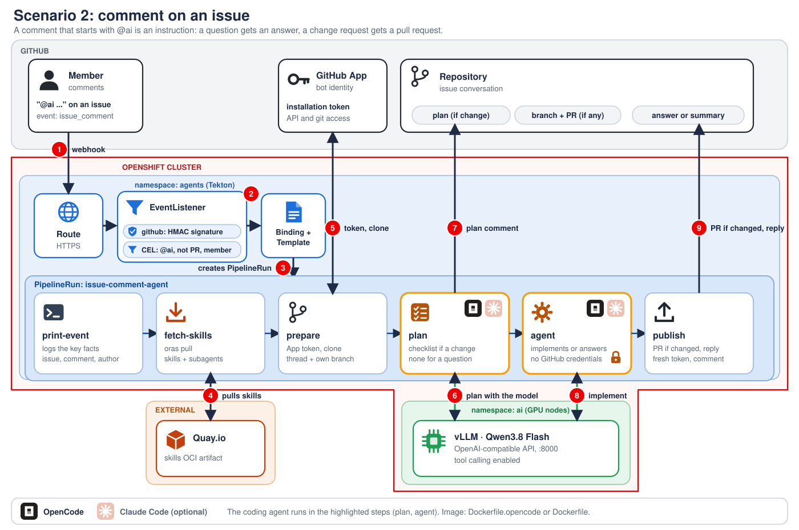
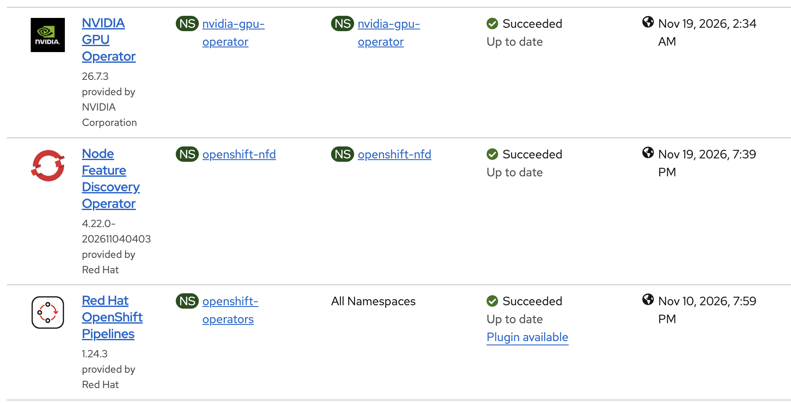
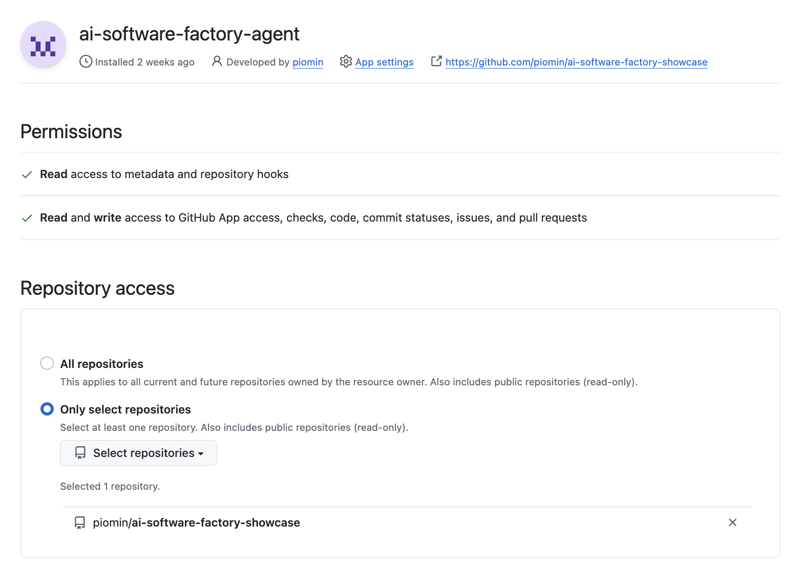
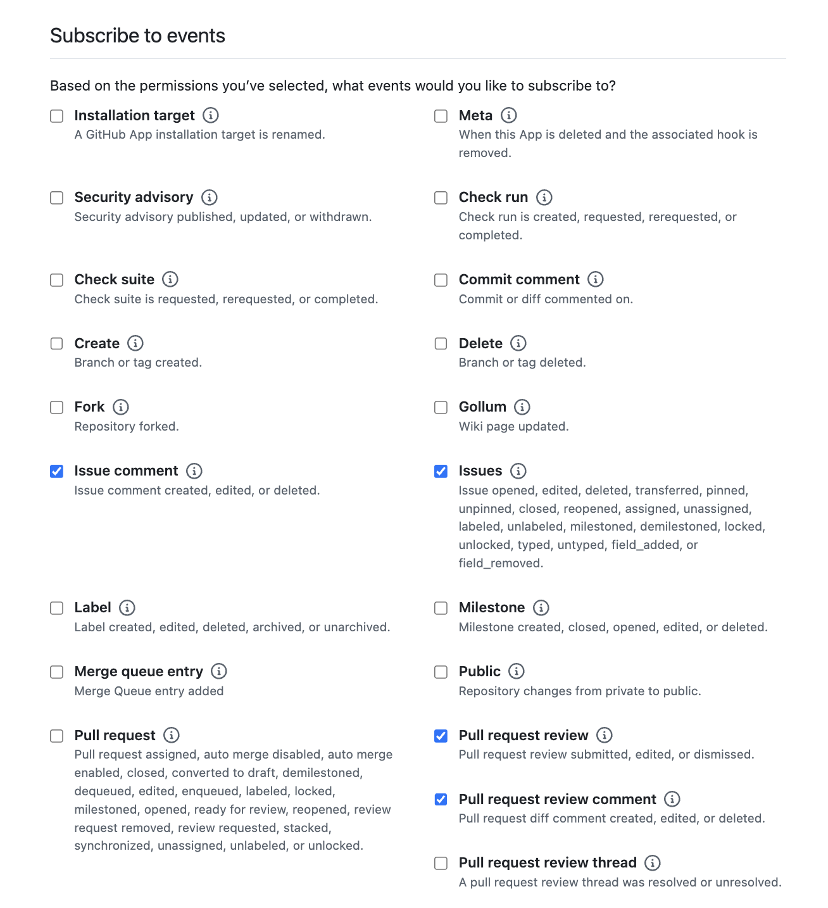
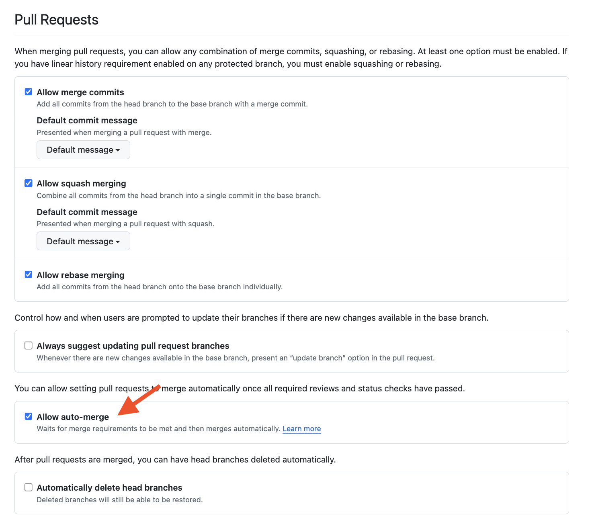

# AI Software Factory on OpenShift

A self-hosted "software factory" that turns GitHub issues and comments into pull requests.
GitHub events are received by Tekton Triggers, executed as Tekton pipelines, and handled by a
coding agent ([OpenCode](https://opencode.ai)) that talks to an open model served by
[vLLM](https://docs.vllm.ai) on GPU nodes in the same cluster. Nothing leaves the cluster except
the calls to GitHub.


*The factory at a glance: GitHub, Tekton on OpenShift, the coding agent and the model on vLLM.*

```
GitHub (issue, comment, review)
   │  webhook
   ▼
OpenShift Route ──► EventListener (Tekton Triggers)
                      ├─ github interceptor  (HMAC signature check)
                      └─ cel interceptor     (who / what / which event is allowed)
                         │
                TriggerBinding ─► TriggerTemplate ─► PipelineRun
                                                        │
              ┌─────────────────────────────────────────┘
              ▼
   print-event ─► fetch-skills ─► prepare ─► plan ─► agent ─► publish
                      │              │        │       │         │
                 OCI artifact     clone +   plan as  OpenCode   commit, push,
                 (skills, agents) branch    comment  + vLLM     PR, reply
                                                      (Qwen)
```

## What it does

| Pipeline | Triggered by | What happens |
|---|---|---|
| `issue-agent` | a new issue (`issues` / `opened`) | Posts a checklist plan as an issue comment, implements the issue on a new branch, opens a pull request, enables auto-merge and replies with a summary. |
| `issue-comment-agent` | an issue comment starting with `@ai` | Treats the comment as an instruction. A question gets an answer; a change request gets a plan, a branch and a pull request. |
| `pr-comment-agent` | a pull request review or review comment | Reads the whole PR conversation, pushes the requested change to the PR branch (or answers a question) and replies on the PR. |

Every trigger only accepts events from users whose `author_association` is `OWNER` or `MEMBER`
and ignores bots. Forks and closed issues or pull requests are skipped.

## Event flows

Each diagram follows one event from GitHub through the OpenShift cluster (Route, EventListener,
PipelineRun in the `agents` namespace) to the model on vLLM (`ai` namespace) and back to GitHub.
The numbers show the order of the main interactions. The orange-framed steps (`plan`, `agent`) are
where the coding agent runs: OpenCode, which the pipelines use, or the optional Claude Code image.
Quay.io only serves the skills artifact. The OpenCode and Claude Code icons are simplified
drawings, not the official logos.

### Scenario 1: new issue


### Scenario 2: comment on an issue



### Scenario 3: review of a pull request


## Repository layout

```
.
├── agents/                              the agent: images and shared configuration
│   ├── Dockerfile.opencode              agent image with OpenCode, git, gh, JDK 25, Maven, skaffold, kubectl
│   ├── Dockerfile                       same tooling with Claude Code (optional, not used by the pipelines)
│   └── configmap-agent-config.yaml      OpenCode config (model, permissions) and the GitHub App token script
├── tekton/                              pipelines and everything that triggers them
│   ├── pipeline-*.yaml                  the three Tekton pipelines
│   ├── triggerbinding-*.yaml            map webhook payloads to pipeline parameters
│   ├── triggertemplate-*.yaml           create the PipelineRuns
│   ├── eventlistener-new-issue.yaml     the single EventListener with four triggers and their filters
│   ├── route-new-issue.yaml             public HTTPS endpoint for the GitHub webhook
│   └── serviceaccount-*.yaml, rolebinding-*.yaml   service account and RBAC for the EventListener
├── secrets/                             secret skeletons with placeholders only (never commit real values)
├── ai/                                  vLLM Deployment and Service for qwen38-flash and qwen3-coder
└── docs/
    ├── diagrams/                        SVG diagrams of the three event flows
    └── images/                          screenshots used in this README
```

Namespaces used: `ai` for models and `agents` for pipelines and triggers.

## 1. Prerequisites

### 1.1 Cluster and GPU nodes

- An OpenShift cluster (the setup was built on ROSA) with permissions to install operators.
- At least one GPU machine pool. Each model deployment in `ai/` requests **2 GPUs**
  (`--tensor-parallel-size=2`), 180 GiB of memory and a 300 GiB cache volume. Both deployments
  ship with `replicas: 0`; run only one at a time unless you have 4 GPUs.
- The model manifests tolerate the `nvidia.com/gpu:NoSchedule` taint. If you taint your GPU nodes
  differently, change the `tolerations` in `ai/`.
- The checkpoints are NVFP4 quantized. Check the vLLM release notes for the GPU generation you
  use, because FP4 kernels are primarily aimed at Blackwell GPUs.
- A default `StorageClass` that supports `ReadWriteOnce` (the manifests use `gp3-csi`).
- Access to `registry.redhat.io` for the vLLM images (the cluster pull secret normally covers it).

### 1.2 Operators

Install from OperatorHub, in this order:

1. **Node Feature Discovery Operator**. After installing, create a `NodeFeatureDiscovery`
   instance (the defaults are fine). It labels nodes that have NVIDIA hardware.
2. **NVIDIA GPU Operator**. After installing, create the default `ClusterPolicy`. It installs
   the driver, container toolkit and device plugin on GPU nodes.
3. **Red Hat OpenShift Pipelines** (Tekton Pipelines and Tekton Triggers). It provides the
   `github` and `cel` cluster interceptors and the `pipeline` service account.


*Installed Operators: Node Feature Discovery, NVIDIA GPU Operator and Red Hat OpenShift Pipelines.*

Verify:

```bash
# GPU nodes are discovered and advertise GPUs
oc get nodes -l feature.node.kubernetes.io/pci-10de.present=true
oc describe node <gpu-node> | grep -A2 'nvidia.com/gpu'

# Tekton is running
oc get pods -n openshift-pipelines
oc get clusterinterceptors
```


*A GPU node with the `nvidia.com/gpu` resource in its capacity and allocatable lists.*

### 1.3 Local tools

`oc`, `podman` (or `docker`), `oras`, optionally `tkn` and `gh`.

### 1.4 Namespaces

```bash
oc new-project ai
oc new-project agents
```

## 2. GitHub

### 2.1 Create the GitHub App

Create a GitHub App (Settings, Developer settings, GitHub Apps) with:

- **Repository permissions**: Contents *read and write*, Pull requests *read and write*,
  Issues *read and write*, Metadata *read-only*.
- **Subscribe to events**: Issues, Issue comment, Pull request review, Pull request review comment.
- **Webhook**: leave it for later (section 7); you need the route host first. Set a webhook secret
  now (you will store it as `github-webhook-secret`).


*Repository permissions of the GitHub App: Contents, Pull requests and Issues set to read and write.*


*Events the app subscribes to: Issues, Issue comment, Pull request review and Pull request review comment.*

The app acts as its own bot user. The pipelines authenticate as the app by minting short-lived
installation tokens, so no personal access token is needed.

### 2.2 Install the app and collect identifiers

1. Install the app on the repository (or repositories) the factory should work on.
2. Collect:
   - **App ID**: shown on the app's settings page.
   - **Installation ID**: the number at the end of
     `https://github.com/settings/installations/<ID>` after you open the installation.
   - **Private key**: generate one on the app's settings page and keep the `.pem` file.


*The app's settings page: the App ID is shown under About.*

### 2.3 Repository settings

- Enable **Allow auto-merge** in the repository settings. The pipelines call
  `gh pr merge --auto`. Auto-merge only waits for something if branch protection requires
  reviews or checks, so configure branch protection on the default branch. Without it a pull
  request is merged right away.


*Repository settings: Allow auto-merge enabled and a branch protection rule requiring a review and status checks.*

- Put an `AGENTS.md` in each target repository. The agent follows it. Typical content:
  coding conventions, "do not edit `target/`", how to build and test the project, and an instruction
  to run the tests and report the result honestly. Nothing verifies the code after the agent
  finishes, so these rules are the quality gate.

### 2.4 Commit identity

The pipelines set the commit author to `ai-software-factory-agent[bot]` with an email like
`5642464+ai-software-factory-agent[bot]@users.noreply.github.com`. Replace the name and the
number in the `GIT_AUTHOR_*` and `GIT_COMMITTER_*` variables of the `publish` steps with your
app's slug and bot user id:

```bash
gh api "/users/<app-slug>%5Bbot%5D" --jq .id
```

## 3. Secrets on OpenShift

The `secrets/secret-*.yaml` files are skeletons. Create the real secrets from the command line:

```bash
# GitHub App credentials used to mint installation tokens
oc create secret generic github-app -n agents \
  --from-literal=app-id=<APP_ID> \
  --from-literal=installation-id=<INSTALLATION_ID> \
  --from-file=private-key.pem=./<app-private-key>.pem

# Shared secret used to verify webhook signatures (same value as in the GitHub App)
oc create secret generic github-webhook-secret -n agents \
  --from-literal=secret=<WEBHOOK_SECRET>

# Hugging Face token to download the model weights
oc create secret generic hf-token -n ai --from-literal=token=<HF_TOKEN>
```

`secrets/secret-claude-github-secrets.yaml` (`ANTHROPIC_API_KEY`, `GH_TOKEN`) is only needed if you run a
Claude Code based variant. The OpenCode pipelines do not use it.

If your Quay repositories are private, create an image pull secret and link it:

```bash
oc create secret docker-registry quay-pull -n agents \
  --docker-server=quay.io --docker-username=<user> --docker-password=<token>
oc secrets link pipeline quay-pull --for=pull -n agents
```

## 4. Container images and skills

### 4.1 Agent image

```bash
podman build -f agents/Dockerfile.opencode -t quay.io/<org>/opencode:latest agents/
podman push quay.io/<org>/opencode:latest
```

The image contains OpenCode, `git`, `gh`, `jq`, JDK 25, Maven, `skaffold` and `kubectl`
(`SKAFFOLD_VERSION`, `KUBECTL_VERSION` and the other versions are build arguments). The
pipelines reference it as `quay.io/pminkows/opencode:latest`; replace that with your own
repository and, preferably, a pinned tag:

```bash
sed -i 's#quay.io/pminkows#quay.io/<org>#g' tekton/pipeline-*.yaml
```

The optional Claude Code image is built the same way from `agents/Dockerfile`.

`skaffold` and `kubectl` are in the image so that an agent can deploy an application to
Kubernetes. They do nothing by default: the agent pods have no kubeconfig or RBAC. Granting that
is a separate and security-sensitive step, and `skaffold` also needs a builder (Jib, buildpacks
or Kaniko) and a registry to push to.

### 4.2 Skills artifact

Skills and subagents are distributed as an OCI artifact: one `tar.gz` with `skills/` and
`agents/` directories in OpenCode format. The `fetch-skills` task pulls it with `oras`, unpacks it
to `/skills/opencode`, and the `prepare` step copies it to `~/.config/opencode`.

```bash
tar -czf skills.tar.gz skills agents
oras push quay.io/<org>/<skills-repo>:<version> skills.tar.gz
```

Set the repository and tag in the `skills-artifact` parameter of the pipelines (default
`quay.io/pminkows/claude-ai-spring-boot:1.3.1`).

## 5. The AI model (vLLM)

The manifests in `ai/` run `vllm serve` for Qwen3.8 Flash (`qwen38-flash`) and Qwen3 Coder
(`qwen3-coder`). The pipelines use **Qwen3.8 Flash**, served as `qwen38_flash`, with tool calling
enabled (`--enable-auto-tool-choice --tool-call-parser=qwen3_coder`) and a 32k context.

`qwen38-flash` keeps its Hugging Face cache on a persistent volume, so create it first:

```bash
cat <<'EOF' | oc apply -n ai -f -
apiVersion: v1
kind: PersistentVolumeClaim
metadata:
  name: qwen38-flash-cache
spec:
  accessModes: [ReadWriteOnce]
  resources:
    requests:
      storage: 300Gi
  storageClassName: gp3-csi
EOF

oc apply -n ai -f ai/deployment-qwen38-flash.yaml -f ai/service-qwen38-flash.yaml
oc scale deployment/qwen38-flash -n ai --replicas=1
```

The first start downloads the weights, which can take a long time. The startup probe allows about
an hour. Watch it with `oc logs -f deployment/qwen38-flash -n ai`.

Verify the endpoint:

```bash
oc port-forward svc/qwen38-flash 8000:8000 -n ai &
curl -s localhost:8000/v1/models | jq '.data[].id'     # expect "qwen38_flash"
```


*The `qwen38-flash` pod is `Running` and `/v1/models` lists `qwen38_flash`.*

The agent reaches the model at `http://qwen38-flash.ai.svc.cluster.local:8000/v1`. This address,
the model name and the context limit live in `agents/configmap-agent-config.yaml`
(`opencode.json`). To switch models, change the provider and model there and nothing else.

Scale the model down when it is not needed (`--replicas=0`) to release the GPUs.

## 6. Tekton: pipelines, triggers and the listener

Apply the manifests in this order:

```bash
# Shared OpenCode config and GitHub App token script
oc apply -n agents -f agents/configmap-agent-config.yaml

# RBAC for the EventListener
oc apply -n agents -f tekton/serviceaccount-issue-agent-listener.yaml \
                   -f tekton/rolebinding-issue-agent-listener.yaml

# Pipelines
oc apply -n agents -f tekton/pipeline-issue-agent.yaml \
                   -f tekton/pipeline-issue-comment-agent.yaml \
                   -f tekton/pipeline-pr-comment-agent.yaml

# Bindings, templates, listener and public route
oc apply -n agents -f tekton/triggerbinding-new-issue.yaml \
                   -f tekton/triggerbinding-issue-comment.yaml \
                   -f tekton/triggerbinding-pr-review.yaml \
                   -f tekton/triggerbinding-pr-review-comment.yaml \
                   -f tekton/triggertemplate-new-issue.yaml \
                   -f tekton/triggertemplate-issue-comment.yaml \
                   -f tekton/triggertemplate-pr-comment.yaml \
                   -f tekton/eventlistener-new-issue.yaml \
                   -f tekton/route-new-issue.yaml
```


*PipelineRuns of the three pipelines in the `agents` namespace, in the OpenShift Pipelines console.*

### 6.1 How events become pipeline runs

The `new-issue` EventListener has four triggers. Each verifies the webhook signature with the
`github-webhook-secret` secret, filters with CEL, and then maps the payload with a binding.

| Trigger | GitHub event | CEL filter (all conditions) | Template, pipeline |
|---|---|---|---|
| `new-issue` | `issues` | action `opened`, author is OWNER or MEMBER | `new-issue`, `issue-agent` |
| `issue-comment` | `issue_comment` | action `created`, issue open, **not a pull request**, not a bot, author OWNER or MEMBER, **body starts with `@ai`** | `issue-comment`, `issue-comment-agent` |
| `pr-review-comment` | `pull_request_review_comment` | action `created`, PR open, not a bot, author OWNER or MEMBER | `pr-comment`, `pr-comment-agent` |
| `pr-review` | `pull_request_review` | action `submitted`, PR open, not a bot, author OWNER or MEMBER, non-empty body | `pr-comment`, `pr-comment-agent` |

Each `PipelineRun` gets its own 1 GiB volume (`volumeClaimTemplate`) for the skills workspace and
a 3 hour timeout.

### 6.2 What a run does

1. **`print-event`**: prints the key facts of the event to the log.
2. **`fetch-skills`**: `oras pull` of the skills artifact, then unpack.
3. **`prepare`**: mints a GitHub App installation token, fetches the issue or PR conversation,
   clones the repository and creates the working branch. This is the only step besides `publish`
   that holds the GitHub App private key.
4. **`plan`**: the agent decides whether code changes are needed. If so, it writes a checklist
   (`- [ ] ...`) and posts it as a comment on the issue or pull request. Questions are not planned
   (`issue-agent` always plans, because a new issue is always a task).
5. **`agent`**: OpenCode implements the change against the vLLM endpoint, following the plan and
   the repository's `AGENTS.md`. It writes a short summary to `.agent-summary.md`.
6. **`publish`**: mints a fresh token, commits and pushes. The issue pipelines also open a pull
   request and enable auto-merge; `pr-comment-agent` pushes to the existing PR branch. The agent's
   summary is then posted as a comment.


*A finished `issue-agent` run: `print-event`, `fetch-skills` and `implement-and-create-pr`.*

### 6.3 Security model

- The `agent` step has **no GitHub credentials**. Committing, pushing and any `gh` command are
  denied in `opencode.json`, and the model only sees code and the issue text.
- The `plan` step receives a one-hour installation token (not the private key) and may only run
  `gh issue comment` or `gh pr comment` (`opencode-plan.json`).
- A fresh token is minted in `publish`, because an agent run can exceed the one-hour token
  lifetime.
- Only `OWNER` and `MEMBER` accounts can trigger runs, bot events are ignored, and
  pull requests from forks are rejected.
- Issue and comment text is untrusted input that reaches the model. The agent runs with a broad
  `bash` permission inside its pod, so keep the pods free of cluster credentials, and consider a
  `NetworkPolicy` that limits egress to the model, GitHub and your Maven repositories.

## 7. Connect GitHub to the cluster

Get the public URL of the listener:

```bash
oc get route new-issue -n agents -o jsonpath='https://{.spec.host}{"\n"}'
```

In the GitHub App settings (or as a repository webhook) set:

- **Payload URL**: the URL above
- **Content type**: `application/json`
- **Secret**: the value stored in `github-webhook-secret`
- **Events**: Issues, Issue comment, Pull request review, Pull request review comment

Check *Recent deliveries* on GitHub. A `202` means the listener accepted the event; a `4xx`
usually means a wrong secret.


*Recent deliveries of the app webhook: a green tick means GitHub got a successful response.*

## 8. Try it

1. Open an issue in the repository as an owner or member (for example, "Add a `/health` endpoint").
2. Watch the run:

   ```bash
   oc get pipelinerun -n agents
   tkn pipelinerun logs -f -n agents --last
   ```

3. The issue gets a plan comment, then a pull request and a summary comment appear.

   
   *The bot posts the plan as a checklist before it starts the implementation.*

   
   *The resulting pull request: opened by the GitHub App, approved by a human reviewer and then merged.*

4. Comment `@ai please also add a unit test` on the issue, or review the pull request with a
   comment, to trigger the follow-up pipelines.

## 9. Troubleshooting

| Symptom | Check |
|---|---|
| No `PipelineRun` is created | Webhook deliveries on GitHub; `oc logs deployment/el-new-issue -n agents`; the sender's `author_association` and the CEL filter. |
| `fetch-skills` fails | `skills-artifact` reference and registry access; the artifact must contain a `.tar.gz`. |
| `prepare` fails when minting a token | App ID, installation ID, key format of the `github-app` secret; the app must be installed on the repository. |
| `agent` hangs or loops | vLLM health (`oc logs deployment/qwen38-flash -n ai`), context limit, and the `3h` timeout. A small model sometimes needs more explicit `AGENTS.md` rules. |
| Pods stay `Pending` in `ai` | GPU capacity, taints and tolerations, and that the NVIDIA GPU Operator is healthy. |
| `publish` fails on push | App permissions (Contents write), branch protection rules, and that the branch does not already exist. |
| Auto-merge could not be enabled | Repository setting *Allow auto-merge* and branch protection on the base branch. |

## 10. Known limitations

- Nothing verifies the code after the agent finishes. A pull request can contain code that does not
  compile, so rely on required status checks and reviews through branch protection.
- The agent task shares a 3 hour pipeline timeout. A very long agent run can be cut off before
  `publish`, and then no pull request is created.
- The model context is 32k tokens. Long issue threads or large repositories reduce quality.
- Comments on pull requests that start with `@ai` are not handled by `issue-comment-agent`
  (the trigger skips pull requests). Pull requests are handled by the review triggers.
